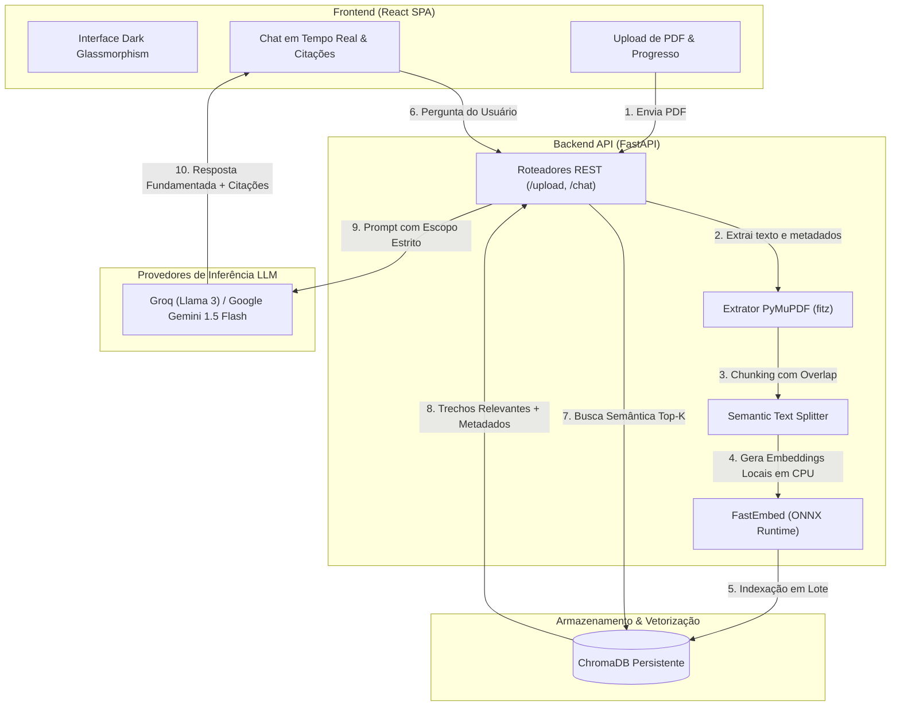

# TalkDoc - Enterprise RAG Document Intelligence & AI Assistant

[](https://fastapi.tiangolo.com/)
[](https://react.dev/)
[](https://www.docker.com/)
[](https://www.trychroma.com/)
[-792EE5.svg)](https://github.com/qdrant/fastembed)
[](https://groq.com/)

Aplicação Web Full-Stack para análise inteligente de documentos baseada em **RAG (Retrieval-Augmented Generation)**. 

O **TalkDoc** permite que usuários façam upload de documentos em formato PDF, executem indexação semântica vetorial em tempo real e conversem com os arquivos via IA Generativa factual, com citações explícitas de trechos e páginas de referência para mitigar alucinações.

---

## Arquitetura do Sistema e Fluxo RAG



---

## Destaques de Engenharia e Performance

* **Embeddings Locais com Zero Custo de API**:
  * Utilização do **FastEmbed** (`BAAI/bge-small-en-v1.5`) executado localmente via **ONNX Runtime** com multithreading em CPU.
  * Indexação ultrarrápida sem cobrança de tokens ou limites de requisições externas (*rate limits*).

* **Indexação em Lote Otimizada (*Batch Processing*)**:
  * Ingestão de vetores no **ChromaDB** em lotes de 100 documentos, acelerando o processamento de livros e relatórios extensos em até 10x.

* **Mitigação de Alucinações & Escopo Estrito**:
  * Engenharia de prompt rigorosa com temperatura 0.0: o modelo responde exclusivamente com base no contexto recuperado do documento.
  * Citações auditáveis indicando o número da página e o trecho exato que originou a resposta.

* **Arquitetura Desacoplada e Isolada**:
  * Deleção atômica de coleções no ChromaDB entre uploads para prevenir *locks* de SQLite e conflitos de concorrência.
  * Proxy reverso integrado via Vite, eliminando atritos de CORS entre navegador e API.

* **Design System Customizado**:
  * Interface moderna desenvolvida em CSS Puro (sem dependências pesadas de UI), com efeito Glassmorphism, paleta Dark Neon e componentes interativos como gabaritos protegidos com efeito spoiler.

---

## Estrutura de Diretórios

TalkDoc/ ├── backend/ │ ├── app/ │ │ ├── api/ # Endpoints REST (/api/upload, /api/chat) │ │ ├── models/ # Schemas Pydantic tipados (ChatRequest, SourceInfo) │ │ ├── services/ # Pipeline RAG, Chunking, Embeddings e LLMs │ │ └── main.py # FastAPI app, Middlewares CORS e Healthcheck │ ├── Dockerfile # Imagem Python 3.10-slim otimizada │ └── requirements.txt # Dependências (FastAPI, PyMuPDF, LangChain, ChromaDB) │ ├── frontend/ │ ├── src/ │ │ ├── components/ # ChatArea, UploadSidebar, ChatHistory, AuthModal │ │ ├── hooks/ # useChat, useDocumentUpload (Custom Hooks React) │ │ ├── services/ # Camada de comunicação HTTP │ │ ├── App.jsx # Orquestrador de estado e persistência local │ │ └── index.css # Design System em CSS Puro (Dark Glassmorphism) │ ├── Dockerfile # Imagem Node.js com Vite Dev Server │ └── vite.config.js # Proxy reverso /api integrado │ ├── docker-compose.yml # Orquestração unificada de containers └── .env.example # Modelo seguro de variáveis de ambiente


---

## Stack Tecnológica

| Camada | Tecnologias |
| :--- | :--- |
| **Backend & API** | Python 3.10, FastAPI, Pydantic, Uvicorn |
| **Pipeline RAG** | LangChain, PyMuPDF (`fitz`), ChromaDB, FastEmbed (ONNX) |
| **Modelos de Linguagem** | Groq (Llama 3 / Mixtral), Google Gemini 1.5 Flash |
| **Frontend** | React 18, Vite, JavaScript moderno, CSS3 Puro (Glassmorphism) |
| **DevOps & Containers** | Docker, Docker Compose |

---

## Como Executar o Projeto

### Pré-requisitos
* [Docker](https://www.docker.com/) e [Docker Compose](https://docs.docker.com/compose/) instalados.
* Uma chave de API gratuita do **Groq** ([console.groq.com](https://console.groq.com/keys)) ou **Google Gemini** ([aistudio.google.com](https://aistudio.google.com/)).

### Passo a Passo

1. **Clone o repositório**:
   ```bash
   git clone https://github.com/caiodantass/TalkDoc.git
   cd TalkDoc 

2. **Configure as variáveis de ambiente**:
   Copie o arquivo `.env.example` para `backend/.env`:
   ```bash
   cp .env.example backend/.env
   ```
   Abra `backend/.env` e insira sua chave de API:
   ```env
   GROQ_API_KEY=sua_chave_groq_aqui
   # OU
   GEMINI_API_KEY=sua_chave_gemini_aqui
   ```

3. **Inicie os containers com Docker Compose**:
   ```bash
   docker compose up --build
   ```

4. **Acesse as interfaces**:
   * **Frontend da Aplicação**: [http://localhost:5173](http://localhost:5173)
   * **Documentação Interativa da API (Swagger)**: [http://localhost:8000/docs](http://localhost:8000/docs)
   * **Healthcheck**: [http://localhost:8000/health](http://localhost:8000/health)

---

## Autor

**Caio Lívio Dantas**  
* Engenheiro de Software / Desenvolvedor  
* LinkedIn: [linkedin.com/in/caio-lívio](https://www.linkedin.com/in/caio-l%C3%ADvio/)  
* GitHub: [@caiodantass](https://github.com/caiodantass)


